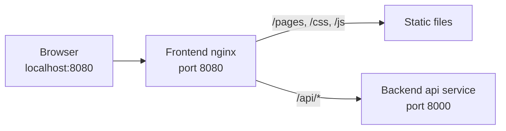

# nginx and browser security headers

**In short:** nginx is the one address the browser uses. It serves the frontend files,
passes `/api` requests to the backend, and attaches the browser security headers required
by the application, plus the caching rule for its files.

## Request flow

The backend Compose project creates the `workforce-ops` network. The frontend Compose
project joins that existing network, where Docker DNS resolves the backend service name
`api`. Because `proxy_pass` has no replacement path, `/api/health` arrives at FastAPI as
`/api/health`.

Two addresses are redirected rather than served: `/` goes to the sign-in page, and
`/set-password.html` (the address in the backend's setup and reset links,
`/set-password.html#token=...`) goes to `/pages/set-password.html`. The `#token=...` part
is never sent to nginx, so it is not in any log; browsers carry it over to the redirect's
new address, where the page reads it and removes it from the address bar. The smoke test
follows such a link in every browser.

The important files are:

- `Dockerfile`: copies only the static application (`pages/`, `css/`, `js/`, `icons/`,
  `images/`, each by name) and nginx configuration, then runs nginx as its built-in
  non-root user.
  A new top-level folder the pages load files from must be added here too; the smoke
  test requests one file from each folder, so a missing one fails CI.
- `nginx/nginx.conf`: serves static files, defines the proxy, and adds the security and
  caching headers.
- `nginx/one-api.sh` (#119): runs before nginx starts (the image runs every script in
  `/docker-entrypoint.d/`) and refuses to start when more than one container answers as
  `api` on the shared network, naming each. nginx looks `api` up once at start and sends
  requests to every address in turn, so with two backend stacks there (say a second one
  with its own database, for testing) links, sign-ins, and changes fail at random: a link
  made through one API is "not valid" for the other (the 400s in the review of #92). No
  answer or one answer starts nginx as before. The backend refuses a second API from its
  side too (backend #213). To run a second stack, give it a network of its own
  (`SHARED_NETWORK`), as the integration tests do.
- `docker-compose.yml`: publishes nginx on `127.0.0.1:8080` and joins the shared network.
- `tests/integration/`: starts an isolated API stand-in and checks the complete browser
  path without depending on a checkout of the backend repository.

## Content Security Policy

The policy contains no `unsafe-inline`, so scripts and styles must remain in their own
files. Each directive has one job:

| Directive | Meaning |
|---|---|
| `default-src 'self'` | Use this origin when a resource type has no more specific rule. |
| `script-src 'self'` | Run JavaScript files from this origin; do not run inline scripts. |
| `style-src 'self'` | Load stylesheets from this origin; do not apply inline styles. |
| `connect-src 'self'` | Let `fetch` call the same-origin `/api` routes. |
| `img-src 'self'` | Load images only from this origin. |
| `font-src 'self'` | Load fonts only from this origin. |
| `object-src 'none'` | Do not embed plugin content. |
| `base-uri 'none'` | Do not let a page change how relative URLs are interpreted. |
| `frame-ancestors 'none'` | Do not allow another page to frame the application. |
| `form-action 'self'` | Submit forms only to this origin. |

**Positions computed by a script** (the blocks of the department week's calendar) still
follow `style-src 'self'`: the script never writes a `style` attribute or HTML that carries
one, which the browser would refuse. It sets CSS custom properties through the CSSOM
(`element.style.setProperty("--block-start", "37.5")`), which the policy allows because only
our own script can call it, and the stylesheet turns them into positions. The values are
numbers computed from server data, never text a user wrote.
`tests/integration/calendar.spec.js` checks in all three browser engines that the blocks land
where they belong behind the real policy and that nothing is refused.

## Other response headers

- `X-Content-Type-Options: nosniff` makes browsers honor the declared content type.
- `Referrer-Policy: strict-origin-when-cross-origin` keeps full paths out of requests to
  another origin while retaining useful same-origin navigation information.
- `Permissions-Policy` disables camera, location, and microphone access because the
  application does not use them.
- `Strict-Transport-Security` is intentionally absent from local HTTP responses because
  browsers ignore it there. The nginx configuration emits a one-year policy with
  `includeSubDomains` when its connection scheme is HTTPS. If production terminates TLS
  before nginx instead, that HTTPS component must add the same header.

## Caching

- `Cache-Control: no-cache` on every page, script, style, and icon. The browser may keep
  a copy, but must ask nginx before each use whether the file changed; an unchanged file
  costs only a short `304 Not Modified` answer. Without the header, browsers guess how long
  a file stays fresh and can run old scripts after a rebuild, or mix old and new ones.
- `/api` answers get no caching header from nginx. The backend marks them `no-store`
  (never kept), because they carry personal data
  ([backend#89](https://github.com/workforce-ops-app/workforce-ops-backend/issues/89)).
- The header is set in the `server` block through a `map` on the path, like HSTS above.
  An `add_header` inside a `location` block would replace all the `server` block's
  `add_header` lines for that location and silently drop the security headers. The smoke
  test checks that both are present.

## Localhost session-cookie compatibility

The Playwright smoke test sends a `Secure; HttpOnly; SameSite=Strict; Path=/` cookie with
the `__Host-` prefix over `http://localhost`, then confirms that the browser stored it.
It runs with Chromium, Firefox, and WebKit, which represent the engines used by Chrome
and Edge, Firefox, and Safari respectively. Chromium and Firefox accept the cookie and
report `SameSite=Strict`. Playwright WebKit differs by host platform: its Windows build
accepts the cookie but reports `SameSite=None`, while its Linux build rejects the cookie.
The smoke test strictly requires the complete cookie from Chromium and Firefox. For
WebKit it adds the observed result to the Playwright test report instead of treating a
missing protection as success or requiring today's behavior forever.

This is an engine-level Phase 1 result, not a claim that every branded browser version
has been manually tested. Before Phase 2 finalizes sessions, confirm the same behavior
in current desktop Chrome, Edge, Firefox, and Safari on their supported operating
systems. Safari on macOS is especially important because Playwright WebKit is not the
branded Safari browser and its Windows and Linux builds already behave differently. The
manual Safari check is tracked separately for Phase 2 so it is not lost in this page.
